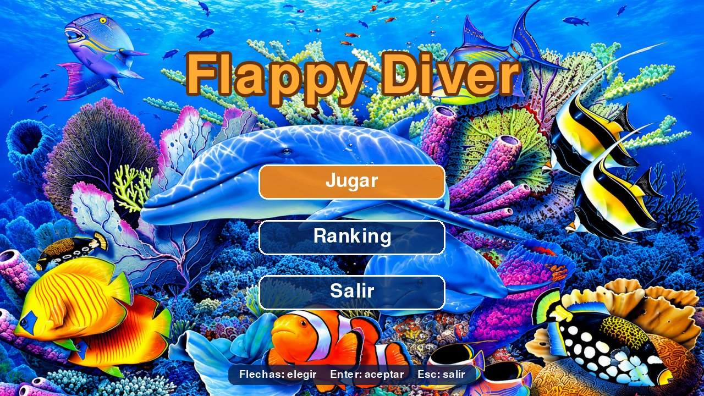
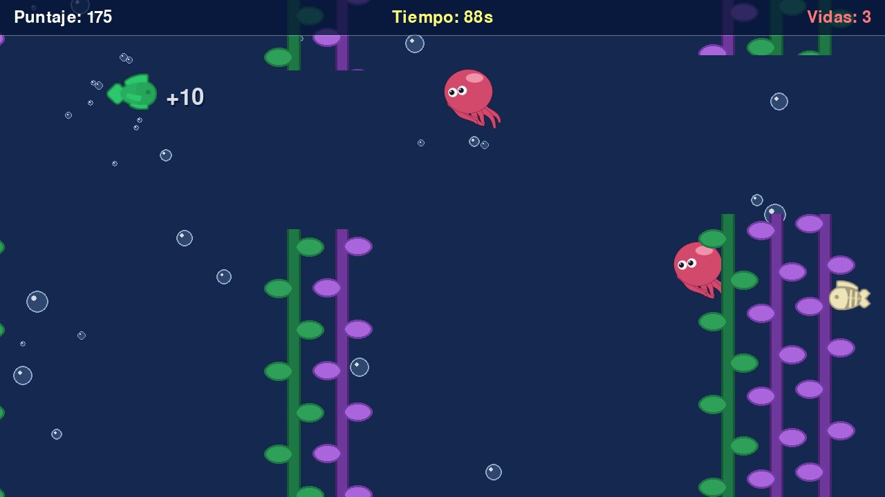
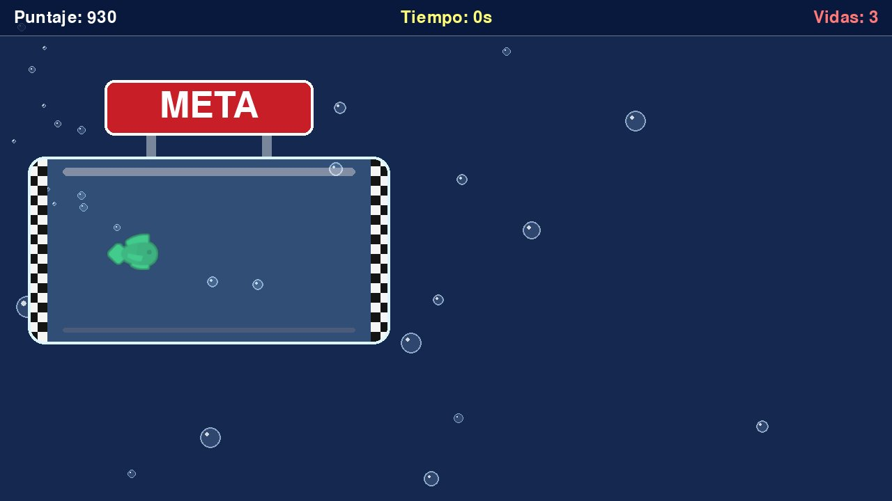
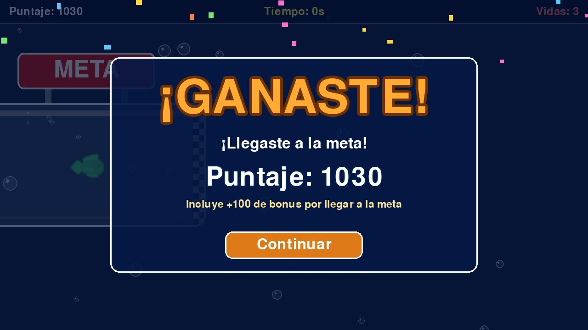
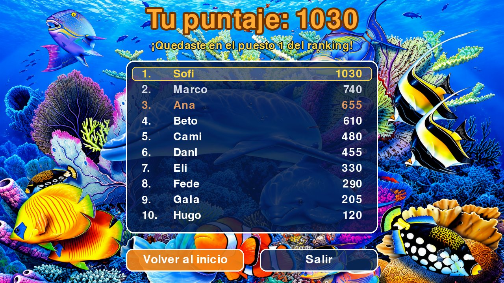

# 🐟 Flappy Diver



## Descripción
**Flappy Diver** (repositorio `flappy-ocean`) es un juego 2D desarrollado en Python con Pygame, ambientado en un acuario. El jugador controla a un pez que nada entre matas de algas violetas y verdes, esquiva peces, pulpos y tiburones, suma puntos y trata de llegar en **2 minutos** a la meta: un tubo de cristal al que el pez entra nadando. Los mejores puntajes quedan guardados en un **ranking Top 10** con SQLite.

Proyecto desarrollado para la materia Software Factory II.

## Capturas

| Partida | La meta |
|---|---|
|  |  |

| ¡Ganaste! | Resultados y ranking |
|---|---|
|  |  |

## Cómo jugar
1. En la **portada** elige **Jugar**, **Ranking** (mejores puntajes) o **Salir**.
2. Presiona el **clic izquierdo** o la **barra espaciadora** para impulsar al pez hacia arriba. El pez cae solo por la gravedad: hay que ir tocando para mantenerlo en el aire.
3. Pasa por los huecos entre las algas: cada mata que dejas atrás suma puntos.
4. Esquiva a los animales marinos: cada uno que pasa de largo también suma.
5. Si chocas con un alga o con un animal pierdes una **vida** (empiezas con 3). El pez queda en su lugar, parpadea y es invulnerable durante 1 segundo. Si fue un alga, reaparece en el centro del hueco.
6. Sobrevive 2 minutos y llega a la **meta**: cuando el tubo se acerca, el pez se acomoda solo y entra.
7. Al terminar, si tu puntaje entra entre los 10 mejores, escribe tu nombre para guardarlo. Después elige **Volver al inicio** o **Salir**.

### Controles

| Dónde | Qué hacer |
|---|---|
| Portada | Clic en los botones, o flechas + Enter. Esc sale del juego |
| Partida | Espacio o clic izquierdo: el pez nada hacia arriba |
| Cartel final | Enter, Espacio o clic en **Continuar** |
| Nombre | Escribe; Enter guarda, Esc omite, Retroceso borra (hasta 10 caracteres) |
| Resultados | Botones **Volver al inicio** y **Salir** (Esc vuelve al inicio) |
| Ranking | Botón **Volver** (o Esc) |

### Puntaje

| Qué | Puntos |
|---|---|
| Mata de algas que dejas atrás | 10 |
| Pez común esquivado | 5 |
| Pulpo esquivado | 15 |
| Tiburón esquivado | 25 |
| Llegar a la meta | +100 de bonus |

Un animal que toca al pez desaparece y no suma. Una partida perfecta ronda los 1000 puntos.

### Los animales
- **Pez:** velocidad media y ondula.
- **Pulpo:** lento, pero sube y baja mucho.
- **Tiburón:** grande, muy rápido y en línea recta.

## Funcionalidades
- [x] Portada con botones Jugar, Ranking y Salir
- [x] Física de nado (impulso y gravedad)
- [x] Obstáculos (matas de algas violetas y verdes) y fauna marina (pez, pulpo y tiburón)
- [x] Burbujas de ambiente
- [x] HUD en una barra superior (puntaje, tiempo y vidas)
- [x] Puntaje por algas y animales esquivados
- [x] Meta (tubo de cristal) con cartel de ganador y Game Over
- [x] Ranking Top 10 con SQLite (pide el nombre al terminar)
- [x] Volver al inicio o salir al terminar
- [ ] Barra de energía y pausa tras chocar un alga _(en desarrollo)_
- [ ] 2 a 3 mapas distintos _(en desarrollo)_

## Requisitos e instalación

### Requisitos previos
- Python 3.8 o superior (probado con 3.12)
- Pygame 2.1 o superior (probado con pygame 2.6.1 y pygame-ce 2.5.5)

### Instalación de dependencias
```bash
pip install -r requirements.txt
```

### Ejecutar el juego
```bash
cd src
python main.py
```
También funciona desde la raíz del repositorio con `python src/main.py`.

### Probar el final sin esperar 2 minutos
La variable `FLAPPY_LIMITE_TIEMPO` acorta la partida (mínimo 10 segundos):

```bash
FLAPPY_LIMITE_TIEMPO=20 python main.py
```
En Windows PowerShell: `$env:FLAPPY_LIMITE_TIEMPO=20; python main.py`

## Ranking y base de datos
Los puntajes se guardan en `database/ranking.db` (SQLite). La base se crea sola al iniciar el juego y **no se sube a Git**. Solo se conservan los **10 mejores** puntajes: cada vez que se guarda uno nuevo, se borra lo que queda fuera del Top 10.

Si la base de datos falla, el juego sigue funcionando y avisa que no se pudo guardar el puntaje.

## Ejecutable para Windows (.exe)
El juego se puede empaquetar en un único `FlappyDiver.exe` que no necesita Python. Se genera con GitHub Actions (pestaña **Actions → Generar FlappyDiver.exe → Run workflow**) o con `construir_exe.bat` en una PC con Windows. El ranking se guarda en `database/` junto al `.exe`. Detalles y avisos de SmartScreen en [docs/generar_exe.md](docs/generar_exe.md).

`FlappyDiver.exe --verificar` (o `python src/main.py --verificar`) comprueba imágenes, sonidos, una partida simulada y la base de datos.

## Estructura del proyecto
```text
flappy-ocean/
├── assets/
│   ├── images/          # portada, jugador, enemigo, pulpo, tiburon, alga, alga_violeta (.png)
│   └── sounds/          # salto.ogg, colision.wav, perder.ogg, musica_fondo.ogg
├── database/            # ranking.db (se crea sola)
├── docs/
│   ├── capturas/        # imágenes de este README
│   ├── requerimientos.md
│   └── diagrama_flujo.md
├── Ejercitacion/        # prácticos de la materia
├── src/
│   ├── main.py            # arranque: portada -> partida -> final
│   ├── partida.py         # la partida: reglas, puntaje y meta
│   ├── jugador.py         # el pez
│   ├── enemigo.py         # animales marinos (pez, pulpo y tiburón)
│   ├── obstaculo.py       # matas de algas
│   ├── meta.py            # tubo de cristal de la meta
│   ├── burbuja.py         # burbujas de ambiente
│   ├── hud.py             # barra con puntaje, tiempo y vidas
│   ├── menu.py            # portada (Jugar, Ranking, Salir)
│   ├── ranking.py         # pantalla del Top 10
│   ├── fin_de_partida.py  # cartel final, nombre y resultados
│   ├── interfaz.py        # botones y texto con borde
│   ├── recursos.py        # carga de imágenes
│   ├── audio.py           # música y efectos (el juego sigue si no hay audio)
│   └── db.py              # ranking en SQLite
├── FlappyDiver.spec     # receta de PyInstaller
├── construir_exe.bat    # genera el .exe en Windows
├── requirements.txt
├── .gitignore
└── README.md
```

## Documentación
- [Requerimientos](docs/requerimientos.md)
- [Diagrama de flujo de pantallas](docs/diagrama_flujo.md)
- [Generar y usar el .exe](docs/generar_exe.md)

## Tecnologías
- Python 3
- Pygame
- SQLite3
- Git / GitHub

## Créditos
- **Código:** Marco Paz, con la ayuda de la cátedra.
- **Imágenes provisorias generadas con código:** `alga.png`, `alga_violeta.png`, `pulpo.png` y `tiburon.png`.
- ⚠️ **Falta indicar la fuente y la licencia** de `portada.png`, `jugador.png`, `enemigo.png` y de los sonidos (`assets/sounds/`).

## Autor
Marco Paz - [@MarcoPazMartinez](https://github.com/MarcoPazMartinez)

Software Factory II - ITES 2026
